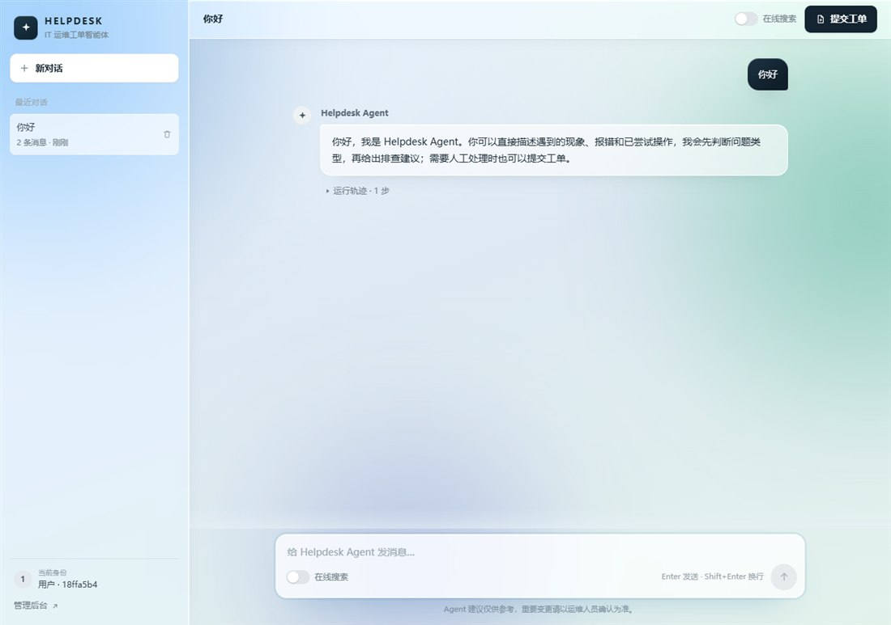
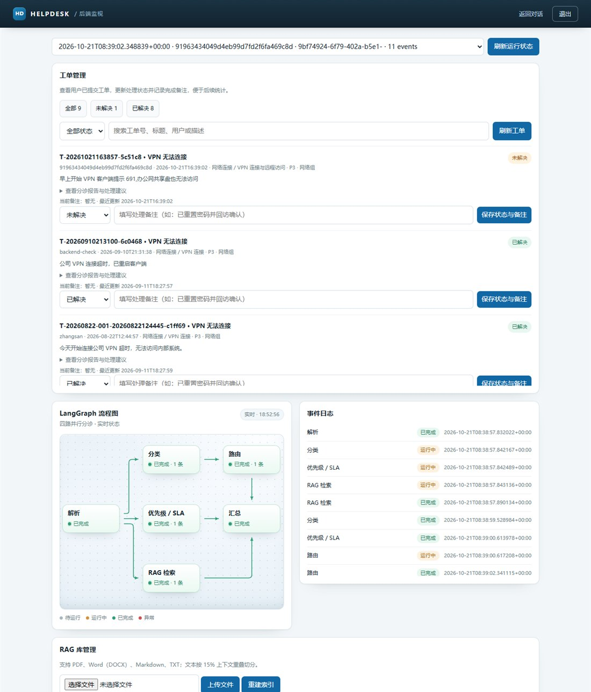
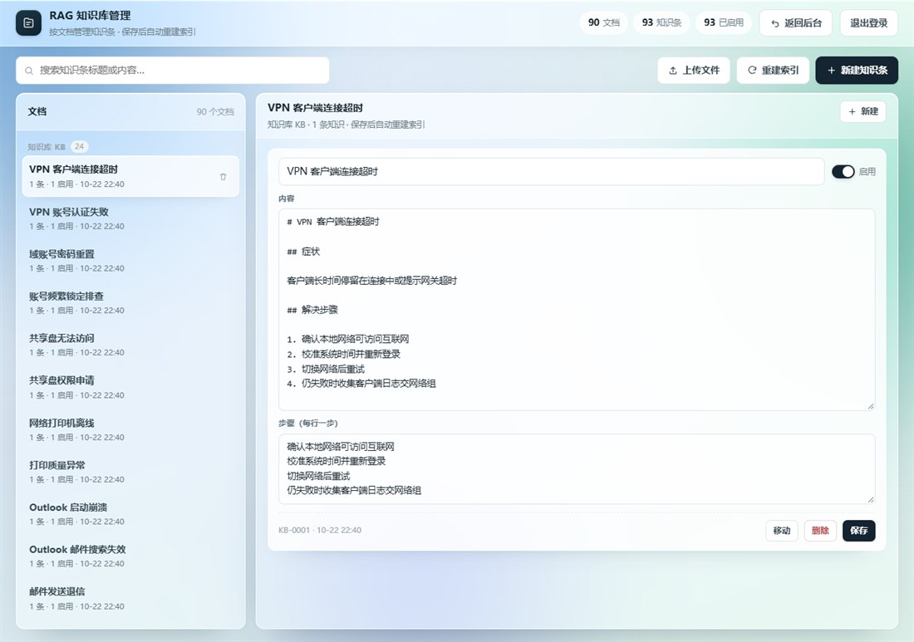
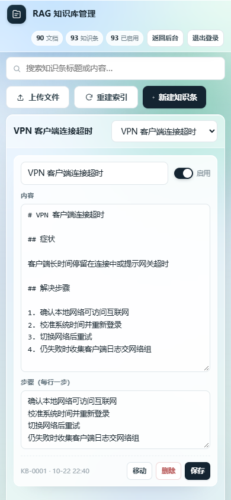
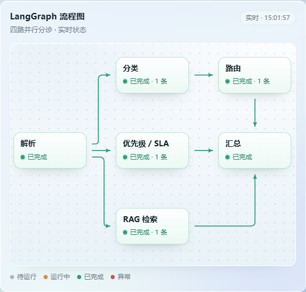
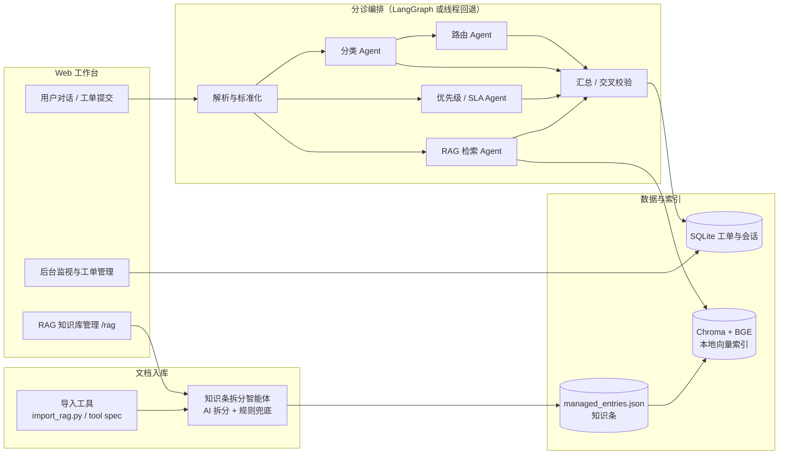

# IT Helpdesk 多智能体工单分诊系统

[](https://github.com/moliu64/IT-Helpdesk-/actions/workflows/tests.yml)
[](pyproject.toml)
[](LICENSE)
[](CONTRIBUTING.md)

一个面向企业 IT 运维场景的开源 AI Helpdesk 原型：把一条自然语言工单变成**分类 / 优先级与 SLA / 可溯源解决方案 / 支持组路由**，并生成客服、工程师和系统都能直接使用的分诊报告。

系统同时提供**用户对话工作台**、**运维后台**和**可增删改迁的 RAG 知识库管理页**，默认用纯 Python 运行，LangGraph 编排与 DeepSeek Harness 编排都是可选增强。

> 用于技术验证与作品演示，不替代生产环境中的 ITSM、权限审批或安全响应流程。仓库内的知识库、历史工单与评测数据均为合成数据，不含真实用户信息。

---

## 目录

- [界面预览](#界面预览)
- [核心特性](#核心特性)
- [系统架构](#系统架构)
- [技术栈](#技术栈)
- [快速开始](#快速开始)
- [使用指南](#使用指南)
- [配置参考](#配置参考)
- [API 概览](#api-概览)
- [评测与验证](#评测与验证)
- [项目结构](#项目结构)
- [部署](#部署)
- [安全说明](#安全说明)
- [已知限制](#已知限制)
- [贡献](#贡献)
- [License 与致谢](#license-与致谢)
- [最近更新](#最近更新)

## 界面预览

**用户对话工作台**：自然语言描述问题，自动意图识别 + 本地知识库检索，支持在线搜索、工单提交与历史会话。

<p align="center">
  
</p>

**运维后台**：工单管理、LangGraph 运行监视（实时状态与事件）、RAG 库入口、用户访问记录。

<p align="center">
  
</p>

**RAG 知识库管理页 `/rag`**：按文档分组管理知识条，支持单条新增、编辑、删除、移动、启停；上传文件由「文档入库智能体」按语义拆成独立知识条后重建索引。

<p align="center">
  
  
</p>

**Agent 运行监视**：流程图按真实节点尺寸绘制，颜色表示运行状态，事件日志可回溯每次分诊。

<p align="center">
  
</p>

**在线演示（用户端）**：<https://060115.top/> · 健康检查：<https://060115.top/healthz>
后台 `/backend` 与 `/rag` 需要先在服务器上配置管理员账号，登录后使用。

## 核心特性

- **多 Agent 并行分诊**：分类、优先级/SLA、RAG 检索三路并发，路由依赖分类结果，汇总层做交叉校验并生成报告。
- **结果是可执行的交付物**：同时输出 `report.md`（给人看）与 `report.json`（给系统用），包含给用户的回复草稿、给工程师的处理建议和自动标签。
- **本地 RAG，零外部向量服务**：Chroma + BGE 中文 Embedding（`BAAI/bge-small-zh-v1.5`），默认离线运行；检索不到时不编造方案，明确提示人工排查。
- **可管理的知识库**：独立的 `/rag` 管理页按文档组织知识条，支持单条 CRUD、跨文档移动、启停、搜索；上传 PDF/DOCX/MD/TXT 后由**文档入库智能体**（LLM 按语义拆分 + 规则兜底）拆成一条条自包含知识条，再重建索引。
- **知识条而不是文本碎片**：入库时优先按文档编号/标题小节拆条，每条含可检索标题、自包含正文与可执行步骤；模型漏拆时用结构规则补回，AI 不可用时自动降级，不会把整篇文档塞进一条。
- **可靠的结构化输出**：所有 Agent 输出顶层强制为 `{"results": [...]}`，经 Pydantic 校验与有限重试，失败时返回受约束的空结果而不是崩溃。
- **三个 Web 界面**：用户对话页、后台监视/RAG 入口、知识库管理页；后台使用服务端签名的 HttpOnly Cookie 登录（无浏览器原生 Basic 弹窗）。界面采用磨砂玻璃质感与按钮微动画，支持 `prefers-reduced-motion` 降级。
- **可观测**：Agent 每一步写入 trace（节点、状态、耗时、结果数），后台实时轮询展示；RAG 检索、重建、对话的慢请求写入运行日志。
- **可评测**：内置 24 篇 KB、64 条历史工单、32 条人工标注评测集，附带评测脚本、82 个自动化测试与 GitHub Actions。
- **一键部署友好**：Windows 中文控制面板一键启动源站与 Cloudflare Tunnel；同时提供 Docker Compose、Nginx、systemd 部署模板。

## 系统架构



分诊链路的四个 Agent 通过小型 JSON 契约解耦，可独立替换；`src/agent_graph.py` 在安装了 LangGraph 时使用真实 `StateGraph`，否则自动回退到 `ThreadPoolExecutor`，保证纯 Python 可运行。详细设计见 [docs/ARCHITECTURE.md](docs/ARCHITECTURE.md)。

## 技术栈

| 层 | 选型 |
| --- | --- |
| 语言与运行时 | Python 3.10–3.13，标准库 HTTP Server（无 Web 框架依赖） |
| LLM | DeepSeek OpenAI 兼容接口（`deepseek-chat` / 可配置），OpenAI SDK |
| RAG | Chroma 1.5（本地持久化） + sentence-transformers + BGE 中文小模型 |
| 校验与配置 | Pydantic v2、PyYAML，配置集中在 `config/config.yaml` |
| 前端 | 原生 HTML/CSS/JavaScript，单文件、玻璃拟态、无 CDN、离线可用 |
| 存储 | SQLite（工单、会话、trace、访问记录）+ JSON 知识条存储 |
| 编排 | Python 线程池（默认）/ LangGraph（可选）/ DeepSeek Harness workflow（可选） |
| 部署 | Windows 控制面板 + Cloudflare Tunnel；Docker Compose / Nginx / systemd 模板 |

## 快速开始

### 环境要求

- Python 3.10–3.13（`pyproject.toml` 约束 `<3.14`）
- Windows 10/11（使用一键控制面板时；Linux/macOS 可用手动方式）
- 首次运行需联网下载 BGE 模型；之后可完全离线
- 部署完整 RAG 演示数据约需 1–2 GB 磁盘空间

### 方式一：Windows 一键启动（推荐）

双击 [`项目控制面板.bat`](项目控制面板.bat)，控制面板会：

1. 创建/复用 `.venv` 并安装依赖；
2. 启动本机源站并等待 `/healthz` 就绪；
3. 启动 Cloudflare Tunnel（若已配置）；
4. 自动打开用户端页面。

控制面板以无控制台窗口方式运行：双击后由静默启动器拉起，不会出现终端窗口；重复双击只会把已有面板切换到前台（单实例），不会叠加多个 PowerShell 面板。启动完成后可直接关闭面板，项目继续在后台运行；再次打开面板可查看状态，只有点击「停止项目」才会停止服务。后台入口：`http://127.0.0.1:8787/backend`，RAG 管理页：`http://127.0.0.1:8787/rag`（默认均需管理员登录）。

### 方式二：手动安装与启动

```powershell
# Windows PowerShell
python -m venv .venv
.\.venv\Scripts\Activate.ps1
python -m pip install -r requirements.txt
python -m pip install -r requirements-dev.txt

# 配置密钥：复制 .env.example 为 .env，并填写 LLM_API_KEY
Copy-Item .env.example .env
# 编辑 .env：LLM_API_KEY=你的 DeepSeek Key

# 首次建立向量索引（自动读取 data/knowledge 与历史工单）
python scripts/build_index.py

# 启动 Web 工作台并自动打开浏览器
python scripts/start.py --open-browser
```

Linux/macOS：

```bash
python3 -m venv .venv
source .venv/bin/activate
pip install -r requirements.txt -r requirements-dev.txt
cp .env.example .env  # 填写 LLM_API_KEY
python scripts/build_index.py
python scripts/start.py --open-browser
```

启动后访问 <http://127.0.0.1:8787/>。未配置 `LLM_API_KEY` 时，LLM 相关 Agent 会返回受约束的空结果，界面仍可打开，不会崩溃。

### 运行 CLI 分诊

```bash
python -m src.main --input data/raw/sample_ticket.txt
```

报告写入 `outputs/<ticket_id>/report.md` 与 `outputs/<ticket_id>/report.json`。也可传入 JSON 工单文件或包含 `工单号/标题/描述/渠道` 等字段的文本。

### 测试与代码检查

```bash
python -m pytest tests -q        # 82 passed
python -m ruff check src scripts tests ui
python -m compileall -q src scripts ui
```

GitHub Actions 会在 Python 3.10 / 3.11 / 3.12 上执行同样的测试与 Ruff 检查。

## 使用指南

### 用户端（`/`）

- 直接用中文描述现象、报错和已尝试操作；系统先识别意图，再决定对话、RAG 排查或工单流程；
- 支持「在线搜索」开关：开启后参考 DuckDuckGo instant answer 的公开结果，并在回答中标注网络信息；离线或请求失败时自动忽略，不影响使用；
- 「提交工单」会运行完整分诊流程并在当前会话生成工单卡片（分类 / 优先级 / SLA / 路由 / 标签）；
- 左侧最近对话可切换、删除；回答下方的「运行轨迹」可展开查看各 Agent 状态。

### 后台管理（`/backend`）

- 首次访问会跳转 `/login`，输入 `.env` 中的 `HELPDESK_ADMIN_USER` / `HELPDESK_ADMIN_PASSWORD`，之后由 HttpOnly Cookie 保持会话（默认 30 天）；
- **工单管理**：按状态筛选、搜索工单，更新处理状态与备注；
- **LangGraph 流程图 / 事件日志**：查看每次分诊的节点状态、结果数量与时间；
- **RAG 库管理**：上传文件、重建索引、检索 Top-5，点击「管理 RAG 知识库」进入 `/rag`；
- **用户访问记录**：按用户查看访问次数、会话与明细。

### RAG 知识库管理（`/rag`）

- 左侧按文档分组：知识库 KB / 历史工单 / 导入文件 / 手工；右侧展示该文档下的知识条；
- 每条知识条可单独**保存、删除、移动（到已有或新建文档）、启用/停用**，修改后自动重建 Chroma 索引并立即用于对话检索；
- 支持跨文档搜索、新建知识条、重建索引；
- 上传 PDF/DOCX/MD/TXT 时由**文档入库智能体**（`src/rag/knowledge_agent.py`）拆分，而不是按固定字数切片：
  - 优先按文档编号/标题小节拆成一条条**自包含知识条**：一个故障现象/排查流程/操作说明对应一条；
  - 每条生成具体标题（如“Crontab 输出堆积导致磁盘爆满”）、完整正文与可执行步骤，检索时直接命中知识条；
  - 模型输出经 Pydantic 校验并重试；模型漏拆的编号小节由结构规则补回；AI 不可用时自动降级为纯规则拆分（`mode=rule`）；
- 同名文件重新上传会整体替换旧知识条；扫描版 PDF 等提取不到文本时返回明确提示，不会产生空知识条；
- 停用的知识条保留在库中但不参与检索；
- 知识条持久化在 `data/knowledge/managed_entries.json`（首次运行自动从 KB、历史工单、imports 灌入），可在测试环境用 `HELPDESK_RAG_STORE` / `HELPDESK_RAG_INDEX_DIR` 隔离。

**专用导入工具**：如果不想打开网页，可以用 `scripts/import_rag.py` 或工具契约 `src/rag/import_tool.py`：

```powershell
# 先预览拆分结果（不落库、不重建索引）
.venv\Scripts\python.exe scripts\import_rag.py "C:\path\运维手册.pdf" --dry-run

# 用 AI 智能体拆分并导入（失败自动回退规则）
.venv\Scripts\python.exe scripts\import_rag.py "C:\path\运维手册.pdf" --mode agent
```

入库智能体的设计、完整 Prompt、工具 Schema 与验证记录见 [docs/RAG_INGEST_AGENT.md](docs/RAG_INGEST_AGENT.md)。

### 数据与索引

- `data/knowledge/`：24 篇合成 KB，Markdown 格式；
- `data/tickets/historical_tickets.json`：64 条合成历史工单；
- `data/knowledge/imports/`：上传文件目录（运行时生成，Git 忽略）；
- `data/tickets/index/`：Chroma 索引目录（运行时生成，Git 忽略）；
- `data/annotated/helpdesk_eval.json`：32 条人工标注评测集。

## 配置参考

### 环境变量（`.env`）

| 变量 | 必填 | 说明 |
| --- | --- | --- |
| `LLM_API_KEY` | 是 | DeepSeek API Key，只从环境变量读取 |
| `LLM_BASE_URL` | 否 | 默认 `https://api.deepseek.com/v1` |
| `LLM_MODEL` | 否 | 默认 `deepseek-chat` |
| `LLM_TEMPERATURE` / `LLM_TIMEOUT` | 否 | 采样温度与单次调用超时 |
| `HELPDESK_ADMIN_USER` / `HELPDESK_ADMIN_PASSWORD` | 部署时必填 | 后台登录账号 |
| `HELPDESK_SESSION_SECRET` | 部署时必填 | Cookie 签名密钥，建议随机长字符串 |
| `HELPDESK_ADMIN_SESSION_DAYS` | 否 | 后台登录有效天数，默认 30 |
| `HELPDESK_COOKIE_SECURE` | 否 | 1 强制 Secure Cookie；未设置时按 HTTPS 代理自动判断 |
| `HELPDESK_HOST` / `HELPDESK_PORT` | 否 | 默认 `127.0.0.1:8787` |
| `HELPDESK_DB_PATH` | 否 | SQLite 数据库路径，默认 `ui/helpdesk.db` |
| `HELPDESK_RAG_PREWARM` | 否 | `1` 启动前同步预热模型（生产默认），`background` 后台预热，`0` 不预热 |
| `HELPDESK_RAG_INGEST_MODE` | 否 | 文档入库拆分模式：`auto`（默认，AI 优先/规则兜底）/ `agent` / `rule` |
| `HELPDESK_RAG_STORE` | 否 | 知识条存储路径，默认 `data/knowledge/managed_entries.json` |
| `HELPDESK_RAG_INDEX_DIR` | 否 | Chroma 索引目录，默认取 `config.yaml` 的 `rag.index_dir` |
| `HELPDESK_RAG_SOURCE_ROOT` | 否 | 首次灌入知识条时的源数据根目录，默认仓库根 |
| `HELPDESK_PUBLIC_URL` / `HELPDESK_ONLINE_PORT` | 否 | 公网演示地址与控制面板端口 |
| `HELPDESK_TUNNEL_CONFIG` / `CLOUDFLARED_PATH` | 否 | Tunnel 配置与 cloudflared 路径（Windows 一键部署） |
| `HF_HUB_OFFLINE` / `TRANSFORMERS_OFFLINE` | 否 | 模型已缓存后设为 1 可完全离线 |

完整示例见 [`.env.example`](.env.example)。请不要把 `.env`、API Key、Tunnel 凭据、SQLite 数据库、上传文件或本地索引提交到 Git。

### `config/config.yaml`

- `llm`：模型、温度、超时；
- `embedding`：`provider: local`、BGE 模型名；
- `rag.index_dir`：向量索引目录；
- `rag.ingest`：文档入库智能体配置（`mode`、`max_entry_chars`、`window_chars`、`max_entries`）；
- `helpdesk.categories`：问题分类枚举；
- `helpdesk.teams`：支持组枚举；
- `helpdesk.sla_map`：P1–P4 对应响应时限。

Agent 的类别、团队、SLA 全部从配置读取，无硬编码。

## API 概览

### 用户端（公开）

| 方法 | 路径 | 说明 |
| --- | --- | --- |
| GET | `/` | 用户对话工作台 |
| GET | `/healthz` | 健康检查 |
| POST | `/api/chat` | 对话（意图识别 + 对话/RAG 检索） |
| POST | `/api/review` | 提交工单并运行完整分诊 |
| GET | `/api/sessions` / `/api/messages` | 历史会话与消息 |
| DELETE | `/api/sessions` | 删除会话 |
| GET | `/api/trace` | 会话 Agent 轨迹 |

### 后台（HttpOnly Cookie 或 Basic 头）

| 方法 | 路径 | 说明 |
| --- | --- | --- |
| GET | `/login` | 管理员登录页 |
| POST | `/api/admin/login` / `/api/admin/logout` | 登录 / 退出 |
| GET | `/backend` | 运维后台 |
| GET | `/api/tickets` / POST `/api/tickets/update` | 工单列表 / 状态与备注 |
| GET | `/api/backend/runs` / `/api/backend/trace` | 运行列表 / 轨迹 |
| GET | `/api/audit/users` / `/api/audit/logs` | 访问记录 |

### RAG 管理（后台 Cookie）

| 方法 | 路径 | 说明 |
| --- | --- | --- |
| GET | `/rag` | 知识库管理页 |
| GET | `/api/rag/library` / `/api/rag/entries` | 文档与知识条 |
| POST | `/api/rag/entries/create` / `update` / `delete` / `move` | 知识条 CRUD 与移动 |
| POST | `/api/rag/documents/delete` | 删除文档及其知识条 |
| POST | `/api/rag/import` | 上传文件（智能体拆分为知识条、重建索引；响应含 `mode` / `warnings`） |
| POST | `/api/rag/rebuild` | 从知识条存储重建索引 |
| GET/DELETE | `/api/rag/files` | 上传文件列表 / 删除文件 |
| GET | `/api/rag/status` / `/api/rag/search` / `/api/rag/documents` | 状态 / 检索 / 兼容文档列表 |

所有 Agent 输出的 JSON 契约详见 [AGENTS.md](AGENTS.md)。

## 评测与验证

### 分诊评测

`python scripts/evaluate.py` 会读取 `data/annotated/helpdesk_eval.json`，计算分类准确率、优先级准确率与 RAG Top-3 命中率，结果写入 `outputs/eval_result.json`。未配置 `LLM_API_KEY` 时记录 `not_run`，不会生成虚构指标。

本仓库保存的一次历史评测结果（2026-08，合成评测集 32 条）：

| 指标 | 结果 |
| --- | --- |
| 分类准确率 | **87.5%**（28/32） |
| 优先级准确率 | **65.6%**（21/32） |
| RAG Top-3 命中率 | **100%**（32/32） |

> 评测集为合成的 32 条用例，仅用于回归对照，不代表线上真实分布；更换模型或 Embedding 后结果会变化。

### 自动化测试与浏览器验收

- `pytest`：**82 passed**（Agent 契约、RAG 拆分/导入、安全、用户页、知识库 CRUD 等）；
- Ruff：`src scripts tests ui` 全部通过；
- Playwright + Edge 真浏览器验收：
  - 后台登录、流程图、RAG 文档、会话持久化：**11/11**；
  - 用户主页面（对话、工单、移动端、刷新保持）：**18/18**；
  - RAG 管理页（CRUD、移动、上传自动索引、隔离）：**18/18**；
  - 生产环境 RAG 链路冒烟：**19/19**。

### RAG 性能

模型与索引在服务启动时预热后，单次检索约 **8–40 ms**；未预热时首次检索需要加载 BGE/Chroma 约 6 秒。知识条修改后重建索引约 **1–2 秒**（108 条知识，模型已预热）。

## 项目结构

```text
.
├── .github/                     # GitHub Actions、Issue/PR 模板
├── config/config.yaml           # 模型、Embedding、RAG、分类/团队/SLA 配置
├── data/
│   ├── knowledge/               # 24 篇合成 KB；imports/ 为运行时上传目录
│   ├── tickets/                 # 64 条合成历史工单；index/ 为生成的 Chroma 索引
│   ├── annotated/               # 32 条评测集与 gold 标注
│   └── raw/sample_ticket.txt    # CLI 样例工单
├── deploy/060115.top/           # Cloudflare Tunnel / Docker / Nginx / systemd 模板
├── docs/
│   ├── ARCHITECTURE.md          # 架构与组件说明
│   ├── RAG_INGEST_AGENT.md      # 文档入库智能体：Prompt、工具与验证记录
│   ├── CHANGELOG.md             # 完整变更记录
│   ├── 启动与部署说明.md         # 中文启动、面板与线上部署说明
│   └── images/                  # README 截图
├── scripts/                     # build_index / evaluate / import_rag / start / 造数脚本
├── src/
│   ├── agents/                  # 分类、优先级、方案检索、路由与 prompts
│   ├── rag/                     # vector_store、managed_store、ingest、knowledge_agent、import_tool
│   ├── agent_graph.py           # 可选 LangGraph / 线程回退编排
│   ├── intent.py                # 对话意图识别
│   ├── ticket_parser.py         # 文本/JSON 工单解析
│   ├── report.py                # 汇总、交叉校验与 Markdown/JSON 报告
│   ├── llm_client.py            # 统一 LLM JSON 客户端（重试/超时/连接复用）
│   └── main.py                  # CLI 入口
├── tests/                       # 82 个自动化测试
├── ui/
│   ├── index.html               # 用户对话工作台
│   ├── backend.html             # 运维后台
│   ├── rag.html                 # RAG 知识库管理页
│   ├── login.html               # 管理员登录页
│   └── server.py                # 单进程 HTTP 服务（页面 + API + 鉴权）
├── workflow/helpdesk.workflow.js # 可选 DeepSeek Harness 编排脚本
├── 项目控制面板.bat / .ps1      # Windows 唯一用户启动入口
├── start_online.ps1 / stop.ps1  # 面板内部启动/停止实现
├── requirements*.txt
├── pyproject.toml
├── CONTRIBUTING.md · SECURITY.md · LICENSE
```

`legacy_contract_review/` 是历史合同审查项目的只读归档，不属于当前运行链路，当前项目不会 import 它。

## 部署

### Windows + Cloudflare Tunnel（当前演示环境）

1. 准备 `.env`：`LLM_API_KEY`、管理员账号、`HELPDESK_SESSION_SECRET`、`HELPDESK_PUBLIC_URL` 等；
2. 配置 `deploy/060115.top/cloudflared-local-config.yml`（Tunnel 凭据只在本地，不提交）；
3. 双击 `项目控制面板.bat` 一键启动；控制面板负责源站健康检查、Tunnel 上线与后台常驻；
4. 停止项目请使用面板按钮或 `stop.ps1`，关闭面板不会停止服务。

更完整的 Windows 部署说明见 [docs/启动与部署说明.md](docs/启动与部署说明.md)。

### Docker Compose / Nginx / systemd

[`deploy/060115.top/`](deploy/060115.top/) 提供容器与网关模板：

- `docker-compose.yml` + `Dockerfile`：容器化运行；
- `nginx.conf.example`：HTTPS 反向代理与额外 Basic 认证示例；
- `it-helpdesk.service.example`：systemd 服务模板；
- `cloudflared-*.yml`：Cloudflare Tunnel 配置模板。

平台部署时通常注入 `PORT`，应用会读取；若有持久磁盘，请同时持久化 `data/tickets/index/`、`data/knowledge/imports/`、`data/knowledge/managed_entries.json` 与 SQLite 数据库。

### 上线检查清单

- [ ] 配置强密码管理员账号与稳定随机的 `HELPDESK_SESSION_SECRET`
- [ ] 使用 HTTPS（反向代理或 Cloudflare）
- [ ] 不要把 `data/tickets/index/`、`data/knowledge/imports/`、`ui/helpdesk.db` 提交到 Git
- [ ] 在网关层叠加 Cloudflare Access / VPN / IP 白名单（后台不应裸奔在公网）
- [ ] 设置 `/healthz` 健康检查与进程守护（systemd / 容器重启策略）
- [ ] 评估模型与 Embedding 的显存/内存、首次下载与磁盘占用

## 安全说明

- 后台使用 `/login` 表单登录，成功后下发 HMAC 签名的 HttpOnly、SameSite=Lax `helpdesk_admin` Cookie；响应中不发送 `WWW-Authenticate`，不会触发浏览器原生 Basic 认证弹窗；
- 修改管理员密码会使已签发 Cookie 立即失效；服务端仍接受合法的 `Authorization: Basic` 供脚本/curl 调试，但不会发起挑战；
- 用户会话使用独立的签名 HttpOnly Cookie 隔离，服务端不信任客户端传入的 `user_id` 做归属判断；
- 所有 LLM 输出经过 Pydantic 校验，RAG 结果只来自本地索引，检索不到时明确提示人工排查，不编造方案；
- 默认仅监听 `127.0.0.1`，公网部署必须自行增加 HTTPS 与访问控制；详见 [SECURITY.md](SECURITY.md)。

## 已知限制

- 本地 BGE 模型首次下载和 Chroma 建库需要一定磁盘空间与时间；生产启动脚本会同步预热模型，启动约多 6–8 秒（可用 `HELPDESK_RAG_PREWARM` 调整）。
- 知识条每次保存/移动/删除都会完整重建一次索引：模型已预热时约 1–2 秒，首次或冷启动时可能更久。
- 采用浏览器轮询而非 WebSocket/SSE，长对话与分诊期间只有加载状态，没有逐 token 流式输出。
- 评测集为合成数据，指标的绝对值仅用于回归对照；优先级判定受 LLM 波动影响。
- 项目定位是演示原型，不含生产级多租户、审计合规、限流、分布式任务队列等能力。

## 贡献

欢迎 Issue 和 Pull Request。提交前请阅读 [CONTRIBUTING.md](CONTRIBUTING.md)，并确保以下命令通过：

```bash
python -m pytest tests -q
python -m ruff check src scripts tests ui
python -m compileall -q src scripts ui
```

代码约定：Agent 输出必须符合 Pydantic 契约且顶层为 `{"results": [...]}`；解决方案只能来自 RAG 结果；类别、团队、SLA 不得硬编码；不提交密钥与本地数据。

## License 与致谢

本项目采用 [MIT License](LICENSE)。

- DeepSeek API 提供 LLM 能力；
- [Chroma](https://www.trychroma.com/) 提供本地向量库；
- [BAAI/bge-small-zh-v1.5](https://huggingface.co/BAAI/bge-small-zh-v1.5) 提供中文 Embedding；
- 项目由早期的合同审查 Demo 改造而来，历史归档位于 `legacy_contract_review/`。

## 最近更新

- **2026-10-23**：RAG 文档入库改为「文档入库智能体」按语义拆成独立知识条（AI 优先、规则兜底、覆盖校验），不再按 900 字固定切片；新增专用导入工具 `scripts/import_rag.py` / `src/rag/import_tool.py`，并用两篇真实运维文档完成端到端验证；索引时把标题与正文一起向量化，显著提升“按故障名检索”的命中率；四个 Web 界面统一升级磨砂玻璃质感与按钮微动画（支持 reduced-motion）；控制面板改为静默单实例启动器，双击不再留下/叠加 PowerShell 终端面板，启动后可关闭面板让项目后台常驻，只有点击「停止项目」才停止服务。
- **2026-10-22**：新增独立 RAG 知识库管理页 `/rag`，知识条支持单条增删改迁与启停；上传文件自动解析、切片并重建索引；引入持久化知识条存储与索引隔离变量；后台登录改为 Cookie 会话，修复认证弹窗、流程图为空、库内文档无法查看；重做用户主页面；启动/停止脚本健壮性修复。
- 完整历史见 [docs/CHANGELOG.md](docs/CHANGELOG.md)。
